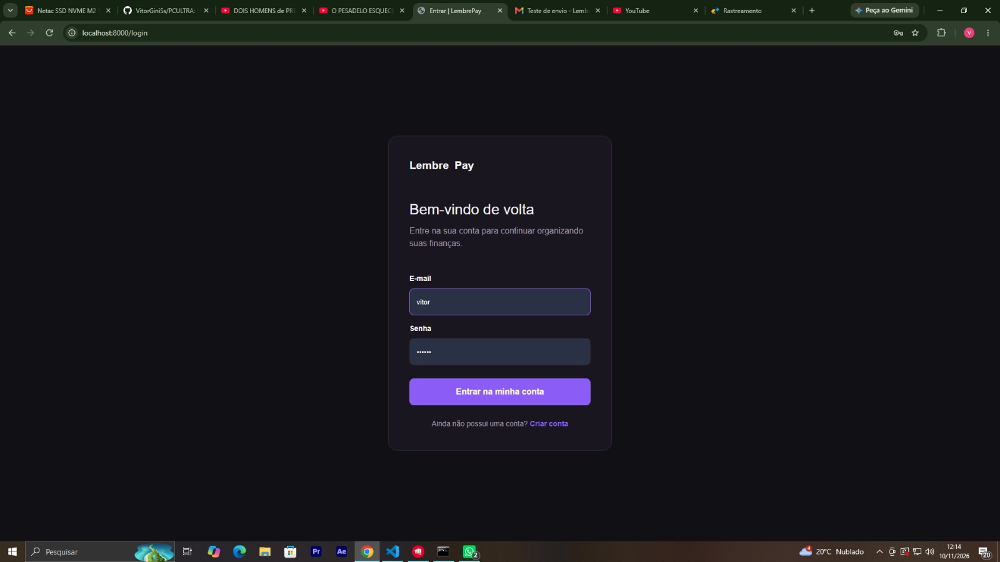
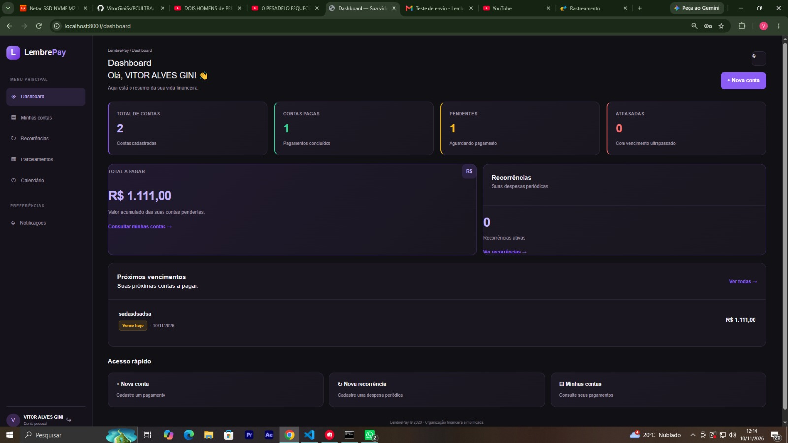
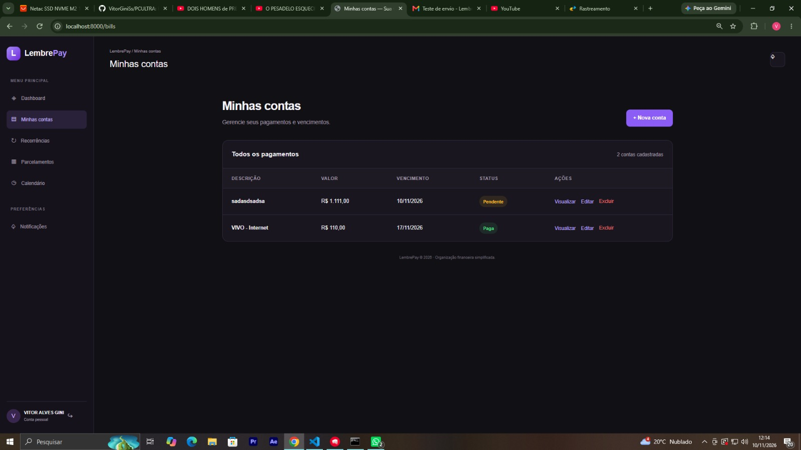
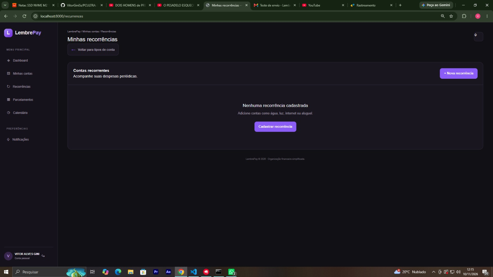
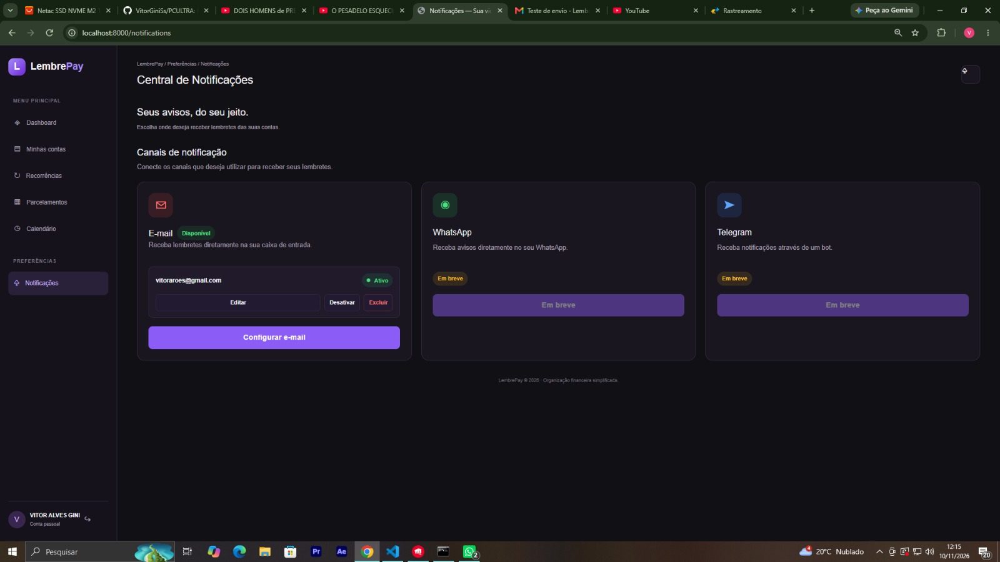
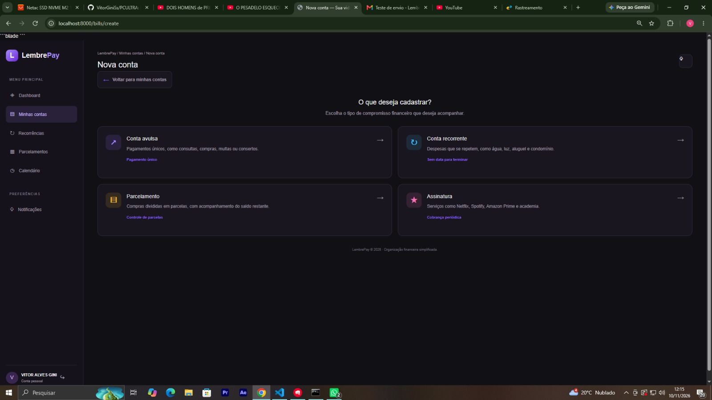
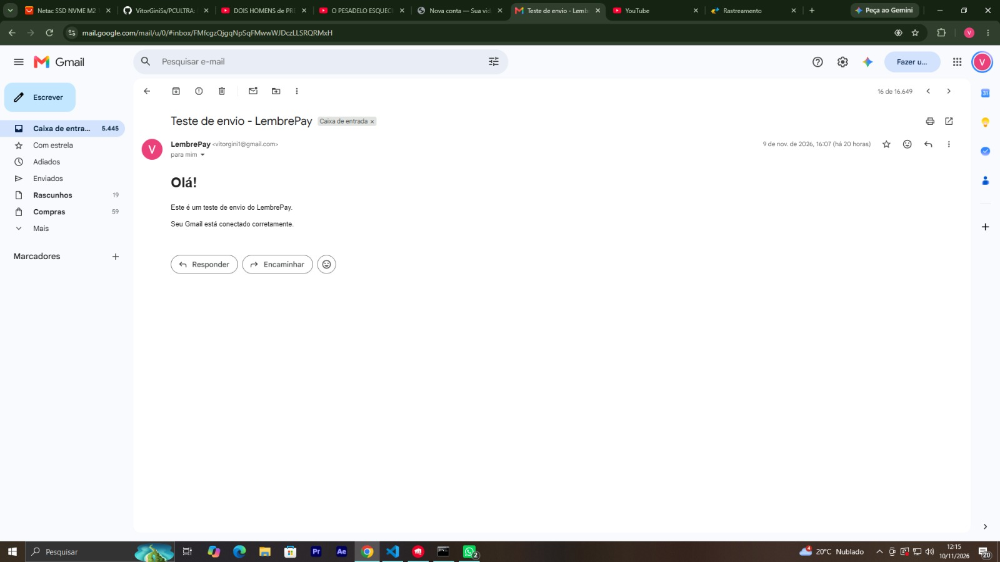
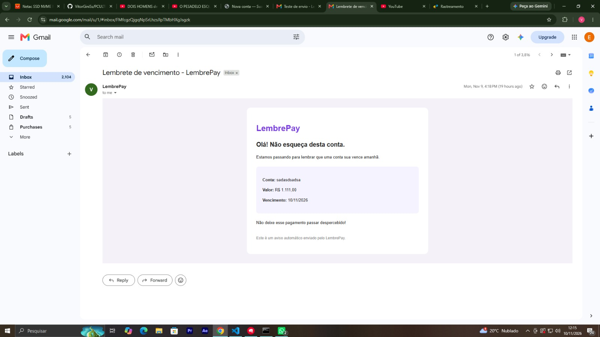

# LembrePay

**Organize suas contas. Não perca seus vencimentos.**

O LembrePay é uma aplicação web desenvolvida para facilitar o gerenciamento de contas e compromissos financeiros. A plataforma permite cadastrar despesas, acompanhar vencimentos e configurar notificações por e-mail para lembrar o usuário de contas próximas do vencimento.

## Funcionalidades

- **Dashboard:** visão geral das contas, valores pendentes, contas pagas e vencidas.
- **Gerenciamento de contas:** cadastro, edição, visualização e controle do status das despesas.
- **Recorrências:** cadastro e organização de compromissos financeiros recorrentes.
- **Notificações por e-mail:** configuração do endereço de destino dos lembretes.
- **Lembretes de vencimento:** envio de e-mail para contas pendentes com vencimento no dia seguinte.
- **Controle de notificações:** registro do envio para evitar o disparo repetido do mesmo lembrete.

## Tecnologias utilizadas

- PHP 8.5
- Laravel 13
- MySQL 8
- Blade
- JavaScript
- Tailwind CSS
- Vite
- Git e GitHub

## Interface

### 1. Login


### 2. Dashboard


### 3. Demais telas da aplicação












## Configuração e instalação

### Pré-requisitos

- PHP 8.5 ou compatível
- Composer
- Node.js e npm
- MySQL 8

### 1. Clone o repositório

```bash
git clone https://github.com/VitorGiniSs/LembrePaySite.git
cd LembrePay
```

### 2. Instale as dependências

```bash
composer install
npm install
```

### 3. Configure o ambiente

```bash
cp .env.example .env
php artisan key:generate
```

Configure as credenciais do MySQL no arquivo `.env` e crie um banco de dados chamado `lembrepay`.

### 4. Execute as migrations

```bash
php artisan migrate
```

### 5. Compile os arquivos de interface

```bash
npm run build
```

### 6. Inicie a aplicação

```bash
php artisan serve
```

Acesse: http://localhost:8000

## Configuração de e-mail

O LembrePay utiliza SMTP para enviar notificações.

Para utilizar o Gmail, configure no `.env` as variáveis `MAIL_MAILER`, `MAIL_SCHEME`, `MAIL_HOST`, `MAIL_PORT`, `MAIL_USERNAME`, `MAIL_PASSWORD`, `MAIL_FROM_ADDRESS` e `MAIL_FROM_NAME`.

As credenciais devem permanecer exclusivamente no arquivo `.env`, nunca no repositório.

## Execução dos lembretes

O comando responsável por verificar e enviar os lembretes é:

```bash
php artisan bills:send-reminders
```

Ele procura contas pendentes com vencimento no dia seguinte, verifica se existe um canal de e-mail ativo e envia a notificação.

**Observação:** o comando foi testado manualmente com recebimento confirmado de e-mail. O agendamento automático diário em servidor ainda precisa ser configurado.

## Objetivo do projeto

Projeto desenvolvido como parte do meu aprendizado e evolução em desenvolvimento web com PHP e Laravel, aplicando conceitos de:

- Desenvolvimento backend.
- Operações CRUD.
- Modelagem e relacionamentos de banco de dados.
- Integração com serviços SMTP.
- Validação de dados.
- Organização de aplicações Laravel.

---

**Desenvolvido por Vitor Gini.**

"Sim, utilizei IA para me ajudar no desenvolvimento..."